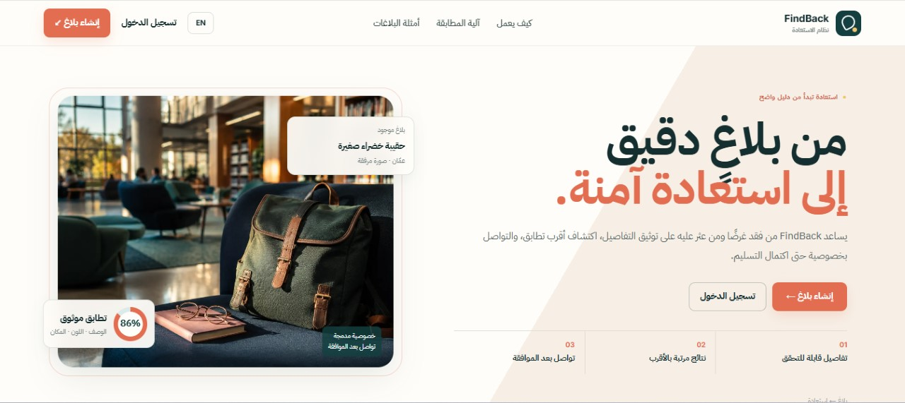
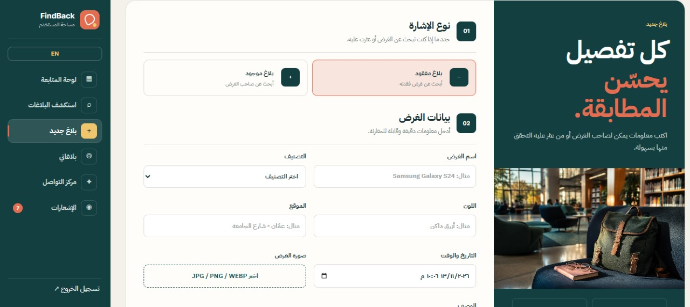
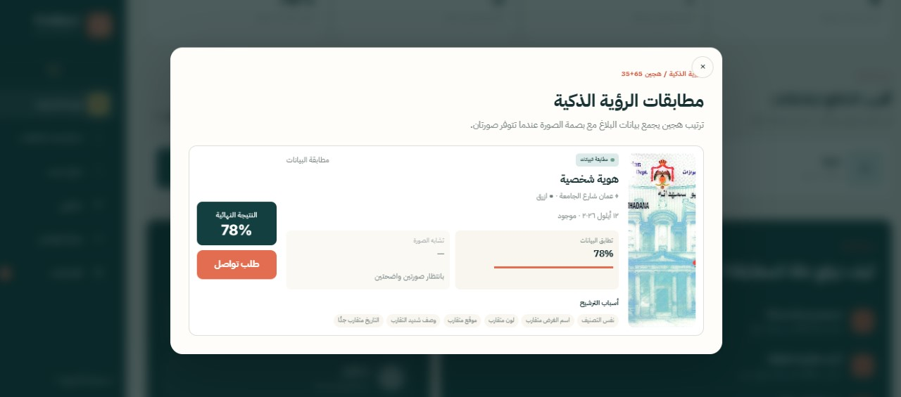
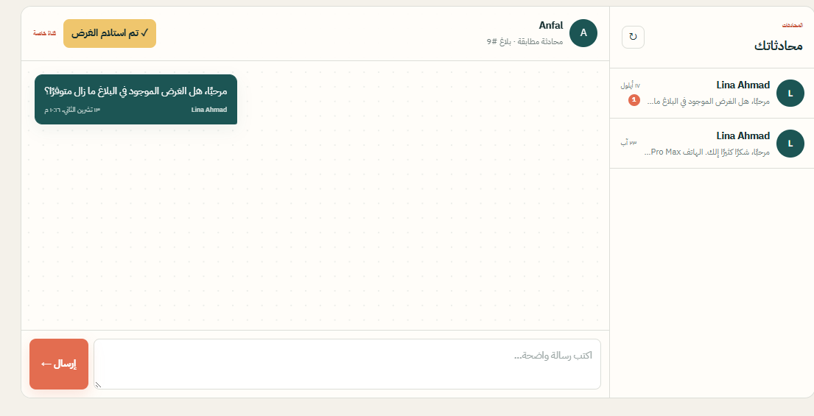
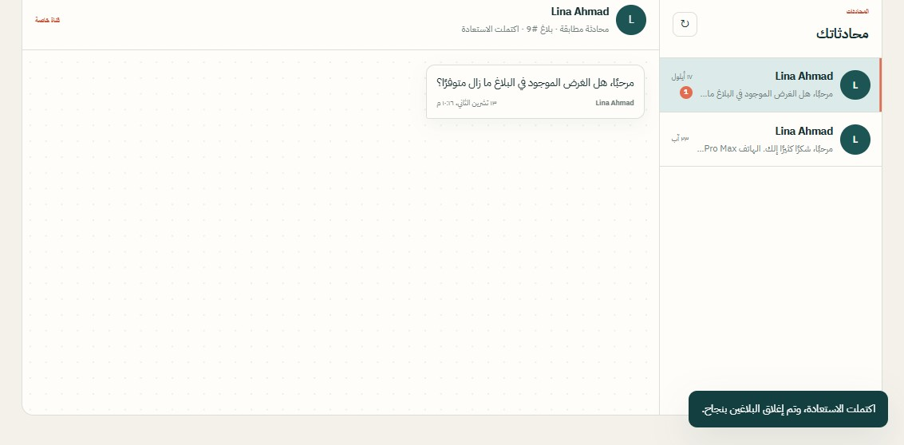

# 🔎 FindBack | Lost & Found Recovery Platform

### A Bilingual Lost-and-Found Platform with Smart Matching & Secure Communication

**FindBack** is a full-stack lost-and-found recovery platform developed using **Python, FastAPI, MySQL, and JavaScript**.

The platform helps users report lost or found items, discover potential matches through a weighted matching engine, communicate securely with other users, and complete the recovery process.

It features a bilingual Arabic/English interface, JWT-based authentication, private messaging, notifications, and an administration dashboard.

> منصة ثنائية اللغة لإدارة المفقودات والموجودات، ومطابقة البلاغات، والتواصل الآمن بين أصحابها، وصولًا إلى استعادة الأغراض وإغلاق البلاغات.

---

## 🎯 Project Overview

FindBack was developed to simplify the process of recovering lost belongings.

Instead of relying on scattered social media posts or manual searching, users can create detailed reports and receive suggested matches based on item information.

When a potential match is identified, users can request contact, communicate through a private conversation, and confirm successful recovery.

The platform supports both regular users and administrators through dedicated interfaces.

---

## ✨ Key Features

### 📝 Lost & Found Reports
- Create lost or found item reports.
- Provide item name, category, color, location, and date.
- Upload an image of the reported item.
- Add a detailed description.
- Manage previously submitted reports.

### 🔍 Smart Matching Engine
- Compare lost and found reports using weighted matching criteria.
- Calculate similarity scores based on item information.
- Rank potential matches from highest to lowest.
- Display suggested matches with scores of 50% or higher.
- Present matching factors to help users understand recommendations.

### 🖼️ Image Comparison Support
- Supports an additional image-comparison component.
- Displays image similarity information when suitable images are available.
- Indicates when image comparison cannot be performed.
- Combines available matching signals in the results interface.

### 🔐 Authentication & Security
- User registration and login.
- JWT-based authentication.
- Argon2 password hashing.
- Protected user-specific operations.
- Separate user and administrator roles.

### 💬 Private Messaging & Contact Requests
- Send contact requests for potential matches.
- Accept or reject contact requests.
- Open private conversations between users.
- Exchange messages securely within the platform.
- Prevent duplicate contact requests.

### ✅ Recovery Confirmation
- Confirm successful item recovery.
- Close linked lost and found reports.
- Mark the associated conversation as completed.
- Preserve previous conversation history.

### 🔔 Notifications
- Contact request notifications.
- New message notifications.
- Support updates.
- Recovery completion notifications.

### 🌍 Bilingual User Interface
- Arabic and English support.
- RTL and LTR layouts.
- Saved language preference.
- Responsive interface.

### 🛠️ Administration Dashboard
- Manage user reports.
- View platform analytics and activity.
- Monitor alerts and notifications.
- Handle user support conversations.
- Access administrative controls.

---

## 📸 Project Screenshots

The following screenshots demonstrate FindBack's main features and user workflow.

### 1. Homepage

The homepage introduces FindBack and provides access to account registration, login, and lost-and-found reporting.



### 2. Create a Lost or Found Report

Users can submit detailed item reports, including category, name, color, location, date, description, and an optional image.



### 3. Smart Matching Results

The matching engine compares item information and displays potential matches with similarity scores and matching explanations.

When image comparison is unavailable, the interface indicates that the result is based on available report data.



### 4. Private Messaging System

Users can communicate through private conversations associated with their reports and contact requests.



### 5. Successful Recovery

After confirming item receipt, the platform marks the recovery as completed and closes the linked reports.



---

## ⚖️ Matching Logic

FindBack uses a weighted matching engine to compare lost and found reports.

| Matching Signal | Weight |
|-----------------|-------:|
| Category | 40% |
| Item Name | 30% |
| Color | 20% |
| Location | 10% |
| **Total** | **100%** |

Matches are ranked from highest to lowest.

Only results with a similarity score of **50% or higher** are displayed.

The matching interface also provides information about the factors contributing to each result.

---

## 🛠️ Technology Stack

| Category | Technologies |
|----------|--------------|
| Backend | Python, FastAPI, Uvicorn |
| Database | MySQL |
| ORM | SQLAlchemy |
| Database Driver | PyMySQL |
| Validation | Pydantic |
| Authentication | JWT, HTTP Bearer |
| Password Security | Argon2 |
| Frontend | HTML5, CSS3, Vanilla JavaScript |
| API Architecture | REST APIs |
| API Documentation | Swagger UI, OpenAPI |
| Additional Component | Image Comparison Support |

---

## 🔄 How FindBack Works

1. **Account Registration:** Users register and sign in securely.
2. **Report Creation:** A user submits a lost or found item report.
3. **Matching:** The system compares the report with available records.
4. **Match Suggestions:** Potential matches are ranked by similarity score.
5. **Contact Request:** The user requests communication with the owner of a matching report.
6. **Approval:** The recipient accepts or rejects the request.
7. **Private Conversation:** Both users communicate through the platform.
8. **Recovery Confirmation:** Item receipt is confirmed.
9. **Report Closure:** The linked reports and conversation are marked as completed.

---

## 📁 Project Structure

```text
FindBack/
├── frontend/
│   ├── index.html
│   ├── styles.css
│   ├── app.js
│   └── assets/
│
├── main.py
├── database.py
├── models.py
├── schemas.py
├── security.py
├── vision.py
│
├── requirements.txt
├── requirements-vision.txt
├── README.md
├── SETUP_AR.md
├── FINDBACK_VISION.md
├── .gitattributes
│
├── homepage.jpg
├── create-report.jpg
├── smart-matching.jpg
├── messaging-system.jpg
└── recovery-completed.jpg
```

---

## 🗄️ Database Design

FindBack uses a relational MySQL database to manage user accounts, reports, communication, and notifications.

| Table | Purpose |
|-------|---------|
| `users` | User accounts, roles, and authentication |
| `item_reports` | Lost and found item reports |
| `contact_requests` | Requests between report owners |
| `conversations` | Private and support conversations |
| `messages` | Conversation messages |
| `notifications` | User and administrator notifications |

SQLAlchemy is used for database operations and ORM-based data management.

---

## ⚙️ Local Setup (Windows)

### Prerequisites

- Python
- MySQL Server
- MySQL Workbench (optional)
- Required Python dependencies

### 1. Clone the Repository

```bash
git clone https://github.com/Anfalatef/FindBack-Lost-and-Found-Platform.git
cd FindBack-Lost-and-Found-Platform
```

### 2. Create the MySQL Database

Execute the following SQL command:

```sql
CREATE DATABASE findback_db
CHARACTER SET utf8mb4
COLLATE utf8mb4_unicode_ci;
```

Update the connection configuration in `database.py` using your local MySQL credentials.

### 3. Create a Virtual Environment

```powershell
python -m venv venv
```

### 4. Activate the Environment

```powershell
Set-ExecutionPolicy -Scope Process -ExecutionPolicy RemoteSigned
.\venv\Scripts\Activate.ps1
```

### 5. Install Dependencies

```powershell
python -m pip install -r requirements.txt
```

For optional image-comparison functionality, review the additional dependencies and setup instructions in `requirements-vision.txt` and `FINDBACK_VISION.md`.

### 6. Run the Application

```powershell
python -m uvicorn main:app --reload
```

The application creates its database tables automatically when it starts, provided the database connection is configured correctly.

### 7. Open FindBack

**Website:**

http://127.0.0.1:8000/frontend/

**API Documentation:**

http://127.0.0.1:8000/docs

---

## 💾 Restoring Demo Data

If the `database_backup` folder is available locally, its demo records can be restored using MySQL Workbench.

1. Start the application to initialize the database tables.
2. Open MySQL Workbench.
3. Navigate to **Server → Data Import**.
4. Select **Import from Dump Project Folder**.
5. Choose the `database_backup` directory.
6. Set `findback_db` as the target schema.
7. Start the import.

**Note:** Demo data is not required to understand the project architecture. Any shared backup should contain only non-sensitive sample data.

---

## 👨‍💼 Administrator Setup

Register a user account normally.

For local development, an administrator can promote an authorized account through MySQL:

```sql
UPDATE users
SET role = 'admin'
WHERE email = 'your-email@example.com';
```

Sign out and sign in again to access the administration dashboard.

This procedure is intended for a trusted local development environment. Production role management should use properly secured administrative controls.

---

## 🔌 Core API Endpoints

| Method | Endpoint | Description |
|--------|----------|-------------|
| POST | `/users/register` | Register a user |
| POST | `/users/login` | Authenticate and receive a JWT |
| GET | `/users/me` | Get the current user |
| POST | `/reports` | Create an item report |
| GET | `/reports` | Browse item reports |
| GET | `/users/me/reports` | View personal reports |
| GET | `/reports/{id}/matches` | Get suggested matches |
| POST | `/contact-requests` | Send a contact request |
| PATCH | `/contact-requests/{id}` | Accept or reject a request |
| GET | `/conversations` | View conversations |
| POST | `/conversations/{id}/messages` | Send a message |
| POST | `/support/conversations` | Start a support conversation |
| PATCH | `/conversations/{id}/complete` | Complete item recovery |
| GET | `/notifications` | View notifications |
| GET | `/admin/statistics` | View administration statistics |

Detailed endpoint specifications and request schemas are available through Swagger UI at `/docs`.

---

## 🧪 Demo Workflow

To test the complete recovery process:

1. Register two test accounts.
2. Create a lost report using the first account.
3. Create a similar found report using the second account.
4. Review the suggested matches.
5. Send a contact request.
6. Accept the request from the second account.
7. Exchange messages through the private conversation.
8. Confirm item receipt.
9. Verify that both linked reports are closed.

---

## 🔐 Security & Privacy

- Passwords are protected using Argon2 hashing.
- Authentication uses JWT tokens.
- Private conversations are linked to authorized users.
- Database credentials and JWT secrets must remain private.
- Never commit `.env` files or real user data.
- Avoid publishing sensitive information through uploaded report images.
- Review authorization and input validation before public deployment.

---

## 🚀 Future Improvements

- Improve matching accuracy using additional validated signals.
- Expand and evaluate image-comparison capabilities.
- Enhance multilingual error and notification messages.
- Add clearer match-score explanations.
- Introduce automated backend and frontend tests.
- Improve deployment configuration and documentation.
- Add more detailed matching performance evaluation.

---

## 👩‍💻 Project Information

**Project:** FindBack – Lost & Found Recovery Platform

**Type:** Full-Stack Training Project

**Developer:** Anfal Atef Abu Samhadana

**Focus Areas:**
- Backend Development
- REST API Development
- Relational Database Design
- Authentication & Authorization
- Matching Algorithms
- Full-Stack Web Development

---

## 📫 Connect With Me

**GitHub:** https://github.com/Anfalatef

**LinkedIn:** https://www.linkedin.com/in/anfal-a-b11231308/

---

⭐ Thank you for exploring FindBack!
